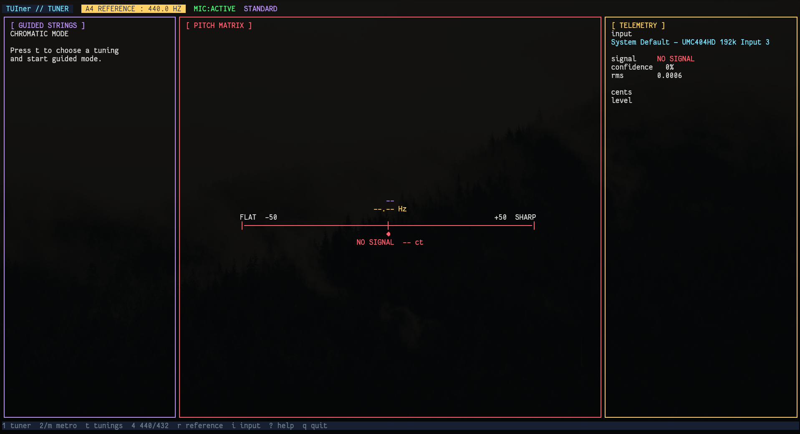

# TUIner

TUIner is a keyboard-first terminal guitar tuner and metronome built with Go, Bubble Tea, Lip Gloss, PortAudio, and a YIN pitch detector. This was VIBECODED.



## Features

- A4=440 Hz / A4=432 Hz one-key switching and custom 400–480 Hz references
- Searchable built-in and user-defined tuning library
- metronome mode with tap tempo, time signatures, and a visual beat indicator
- Vim-style navigation and contextual key hints

## Controls

### Global

| Key | Action |
| --- | --- |
| `1` | Tuner |
| `2` / `m` | Metronome |
| `t` | Tuning library |
| `4` | Toggle A4 between 440 Hz and 432 Hz |
| `r` | Enter a custom A4 reference |
| `i` | Choose the audio input source |
| `?` | Help overlay |
| `Esc` | Cancel / back |
| `q` / `Ctrl-C` | Quit |

### Tuner

| Key | Action |
| --- | --- |
| `j` / `k`, `h` / `l` | Move through strings |
| `gg` / `G` | First / last string |

### Tuning library

| Key | Action |
| --- | --- |
| `j` / `k` | Move through tunings |
| `h` / `Left` | Return without changing the tuning |
| `l` / `Right` / `Enter` / `Space` | Select tuning and begin guided mode |
| `gg` / `G` | First / last tuning |
| `/` | Search tuning library |

### Metronome

| Key | Action |
| --- | --- |
| `h` / `l` | BPM −/+1 |
| `j` / `k` | BPM −/+5 |
| `gg` / `G` | 30 / 300 BPM |
| `Enter` | Tap tempo |
| `Space` | Start / stop |
| `[` / `]` | Previous / next time signature |

## Terminal fallbacks

- Set `NO_COLOR=1` or run with `--no-color` to disable color.
- Run with `--ascii` to force ASCII borders and meters.
- `TERM=dumb` disables color and Unicode decoration.
- A non-UTF-8 locale automatically selects ASCII meters and borders.

## Dependencies

- Go 1.25.5+ (older distribution packages may need an upgrade)
- A C compiler (CGO must be enabled)
- PortAudio 19
- ALSA development headers on Linux
- `pkg-config`

Arch Linux:

```bash
sudo pacman -S base-devel pkgconf portaudio alsa-lib go
```

Debian/Ubuntu:

```bash
sudo apt-get install build-essential pkg-config portaudio19-dev libasound2-dev golang-go
```

## Install and run

Install `TUIner` into your user PATH:

```bash
git clone https://github.com/keagancook/TUIner.git
cd TUIner
GOBIN="$HOME/.local/bin" go install .
TUIner
```

For a repository-local build instead:

```bash
go build -o TUIner .
./TUIner
```

## Custom tunings

Add entries to `~/.config/TUIner/custom_options.json` using the existing format:

```json
{
  "tunings": [
    {
      "name": "My Tuning",
      "notes": ["D2", "A2", "D3", "G3", "A3", "D4"]
    }
  ]
}
```

Notes may use sharps or flats and must include an octave. User entries are merged with the built-in tuning library and are searchable by name.

## Verification

```bash
go test -race ./...
go vet ./...
go mod verify
```

CI also builds the app and checks Go vulnerability advisories. System PortAudio
and ALSA libraries are provided by your package manager and need to be kept
updated separately. Physical device-unplug behavior and non-Linux platforms have
not been verified by the automated tests.

See [SECURITY.md](SECURITY.md) for local microphone, diagnostic-log, and vulnerability-reporting details.

Original project by [SteveMCWin](https://github.com/SteveMCWin/ttune), licensed under MIT.
